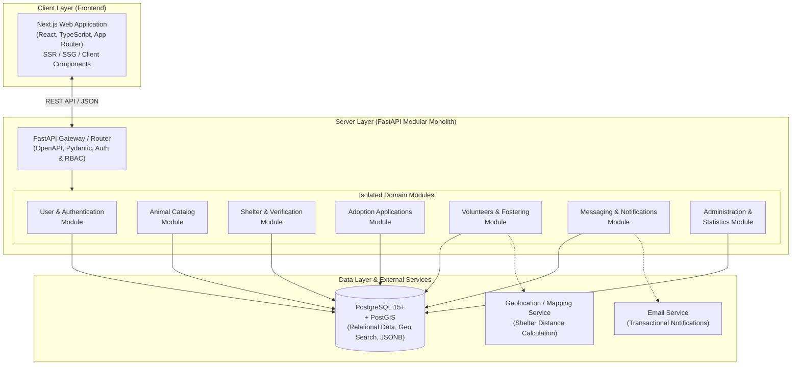

# Animal Aid Platform

> **Regional web platform for coordinating aid to homeless animals.**  
> *Initial pilot deployment region: Ida-Viru County, Estonia.*

[](docs/adr/001-frontend-technology-choice.md)
[](docs/adr/002-backend-technology-choice.md)
[](docs/adr/002-backend-technology-choice.md)
[](docs/adr/003-database-choice.md)
[](docs/adr/004-application-architecture-choice.md)
[](docs/adr/)
[](#target-region-and-languages)
[-brightgreen?style=flat-square)](docs/requirements/SRS.md)

---

## Table of Contents

- [About the Project](#about-the-project)
  - [Project Purpose and Goals](#project-purpose-and-goals)
  - [Target Region and Languages](#target-region-and-languages)
- [Core MVP Features](#core-mvp-features)
- [Out of Scope for MVP](#out-of-scope-for-mvp)
- [User Roles and Access Control](#user-roles-and-access-control)
- [Architecture and Technology Stack](#architecture-and-technology-stack)
  - [Architecture Diagram](#architecture-diagram)
  - [Technology Decisions (ADRs)](#technology-decisions-adrs)
- [Project Structure and Documentation](#project-structure-and-documentation)
- [Roadmap](#roadmap)
- [Contributors](#contributors)

---

## About the Project

**Animal Aid Platform** is a regional web application designed to unite animal shelters, prospective adopters, and volunteers into a centralized digital ecosystem. The project addresses the problem of fragmented information regarding homeless animals, simplifies the pet adoption process, and streamlines volunteer aid and temporary fostering coordination.

### Project Purpose and Goals

- **Information Centralization:** A single, searchable public catalog aggregating animal listings from participating shelters across the region.
- **Simplified Adoption:** A structured and transparent online adoption application workflow with status tracking and direct shelter messaging.
- **Volunteer Coordination:** A hub for shelters to publish assistance tasks (transportation, socialization, feeding, walking, events) and for volunteers to respond.
- **Temporary Fostering:** Dedicated coordination for temporary home care (fostering requests by shelters and offers by volunteers).
- **Direct & Secure Communication:** Built-in messaging between adopters, volunteers, and shelter representatives while safeguarding personal contact information.
- **Smart Local Assistance:** Proactive suggestion of the nearest animal shelter based on browser geolocation or manual address entry.

### Target Region and Languages

- **Pilot Region:** Ida-Viru County (*Ida-Virumaa*), Estonia, architected for scalable expansion to other regions.
- **Multilingual Support:** Complete localization in three languages:
  - 🇪🇪 **Estonian** (*Eesti*)
  - 🇷🇺 **Russian** (*Русский*)
  - 🇬🇧 **English** (*English*)  
  *(with automatic browser language detection and persistent manual switching)*.

---

## Core MVP Features

The Minimum Viable Product (MVP) covers the following key functional modules:

| Module | Functional Scope |
|---|---|
| **Animal Catalog & Search** | Public catalog accessible without authentication. Advanced filtering by species, age, sex, size, shelter, health condition, and behavior characteristics. Detailed animal profiles with photo galleries. |
| **Shelter Management** | Shelter onboarding with administrative verification. Authorized shelter representatives can manage their shelter profile, create and edit animal cards, and track statuses. |
| **Adoption Applications** | Authenticated users can submit adoption applications (including for multiple animals simultaneously). Built-in inquiry chat. *Core Rule:* A listing is only marked as "Adopted" once the shelter confirms the physical adoption. |
| **Volunteer Hub** | Volunteer profiles with skills, availability, and location. Shelters can publish tasks (transportation, care, socialization, supplies delivery), and verified volunteers can apply. |
| **Temporary Fostering** | Bilateral fostering module: shelters can post fostering requests, and volunteers can post fostering availability and care conditions. |
| **Geolocation Assistance** | Fast help request workflow with automated suggestion of the nearest registered shelter (via browser geolocation or manual location input). |
| **Internal Messaging** | Direct, secure in-platform conversations between applicants, volunteers, and shelters without exposing private contact details. |
| **Notifications** | In-app alerts and transactional email notifications for adoption status updates, verification decisions, and new incoming messages. |
| **Administration & Moderation** | Administrative dashboard for shelter and volunteer verification, cross-shelter listing moderation, user management, and aggregate platform metrics. |

---

## Out of Scope for MVP

To ensure high implementation quality, stability, and delivery within fixed academic deadlines, the following features are **explicitly excluded from the MVP** and planned for future iterations:

- [ ] AI-powered automated pet matching assistant.
- [ ] Public lost-and-found announcement board with interactive map.
- [ ] Automated scraping / importing of animal listings from external websites and social networks.
- [ ] Public user and shelter ratings or review systems.

---

## User Roles and Access Control

The platform enforces a strict Role-Based Access Control (**RBAC**) system:

```text
       [Guest]
          │  (Free Registration)
          ▼
   [Registered User]
    ┌─────┴─────┐
    │           │ (Application + Admin Verification)
    ▼           ▼
[Volunteer]  [Shelter Representative]
    │           │
    └─────┬─────┘
          ▼
   [Platform Administrator]
```

| Permission / Capability | Guest | Registered User | Shelter Representative | Volunteer | Platform Administrator |
|---|:---:|:---:|:---:|:---:|:---:|
| Browse public animal catalog | ✅ | ✅ | ✅ | ✅ | ✅ |
| Submit adoption applications | ❌ | ✅ | ✅ | ✅ | ✅ |
| Submit assistance requests to shelters | ❌ | ✅ | ✅ | ✅ | ✅ |
| Manage own shelter's animal listings | ❌ | ❌ | ✅ | ❌ | ✅ (All shelters) |
| Create volunteer tasks | ❌ | ❌ | ✅ | ❌ | ✅ |
| Respond to volunteer tasks | ❌ | ❌ | ❌ | ✅ | ✅ |
| Publish temporary fostering offers | ❌ | ❌ | ❌ | ✅ | ✅ |
| Publish temporary fostering requests | ❌ | ❌ | ✅ | ❌ | ✅ |
| Use internal messaging | ❌ | ✅ | ✅ | ✅ | ✅ |
| Verify shelters and volunteers | ❌ | ❌ | ❌ | ❌ | ✅ |
| Account blocking & content moderation | ❌ | ❌ | ❌ | ❌ | ✅ |
| View administrative analytics | ❌ | ❌ | ❌ | ❌ | ✅ |

---

## Architecture and Technology Stack

All architectural decisions follow the **ADR (Architecture Decision Records)** standard and are documented in [`docs/adr/`](docs/adr/).

### Architecture Diagram

The system is built as a **Modular Monolith** ([ADR-004](docs/adr/004-application-architecture-choice.md)). This architecture ensures straightforward deployment as a single unit, local ACID transactions across domain entities, strong module boundaries, low operational complexity, and the flexibility to extract microservices in the future.



### Technology Decisions (ADRs)

| Component | Selected Technology | Key Decision Drivers | Decision Record |
|---|---|---|:---:|
| **Frontend** | **Next.js** (React, TypeScript) | Server-Side Rendering (SSR) & Static Site Generation (SSG) for fast first load and search engine optimization (SEO) of the public animal catalog. Built-in App Router routing, component reuse, and TypeScript type safety. | [ADR-001](docs/adr/001-frontend-technology-choice.md) (Accepted) |
| **Backend** | **Python (FastAPI)** | High development speed, clean and readable syntax, native async I/O, automatic interactive OpenAPI (Swagger) documentation, and schema validation via Pydantic. | [ADR-002](docs/adr/002-backend-technology-choice.md) (Accepted) |
| **Database** | **PostgreSQL + PostGIS** | ACID compliance, robust relational integrity, PostGIS extension for spatial queries (finding nearby shelters), and JSONB support for flexible animal attributes. | [ADR-003](docs/adr/003-database-choice.md) (Accepted) |
| **Architecture** | **Modular Monolith** | Single-unit deployment, local transactions across domain models, clear module boundaries, low infrastructure overhead, ideal for a compact team with future microservice extractability. | [ADR-004](docs/adr/004-application-architecture-choice.md) (Accepted) |

---

## Project Structure and Documentation

```text
animal-aid-platform/
├── docs/                                # Project documentation
│   ├── requirements/                    # Software Requirements Specification
│   │   └── SRS.md                       # Complete SRS document (v0.2 Draft)
│   └── adr/                             # Architecture Decision Records (All Accepted)
│       ├── 001-frontend-technology-choice.md       # Decision: Next.js
│       ├── 002-backend-technology-choice.md        # Decision: Python FastAPI
│       ├── 003-database-choice.md                  # Decision: PostgreSQL + PostGIS
│       └── 004-application-architecture-choice.md  # Decision: Modular Monolith
└── README.md                            # Main project overview and guide
```

> 📄 **Key Reference Documentation:**
> - [Software Requirements Specification (SRS v0.2)](docs/requirements/SRS.md) — Comprehensive functional & non-functional requirements, use cases, business rules, and open questions.
> - [Architecture Decision Records (ADRs)](docs/adr/) — Technical context, evaluated options, trade-offs, and decision outcomes.

---

## Roadmap

- [x] **Phase 1: Requirements Formulation & Scope Definition**
  - [x] Identify stakeholders, core domain workflows, and MVP boundaries
  - [x] Draft and refine Software Requirements Specification ([SRS v0.1 / v0.2](docs/requirements/SRS.md))
- [x] **Phase 2: Architectural & Technical Design**
  - [x] Evaluate and accept key technical choices ([ADR 001–004](docs/adr/))
  - [x] Define Role-Based Access Control (RBAC) and domain module boundaries
- [ ] **Phase 3: Database Modeling & API Specification**
  - [ ] Design PostgreSQL relational schema & migrations (ERD)
  - [ ] Define OpenAPI / REST API contracts between Next.js and FastAPI
- [ ] **Phase 4: Backend Implementation (FastAPI)**
  - [ ] Implement core authentication (JWT) and RBAC middleware
  - [ ] Develop Catalog, Shelter, Adoption, and Volunteer domain modules
  - [ ] Integrate transactional notification dispatch (in-app + email)
- [ ] **Phase 5: Frontend Implementation (Next.js)**
  - [ ] Build responsive UI layouts (Desktop & Mobile)
  - [ ] Implement SSR animal catalog, search filters, and detail cards
  - [ ] Implement user, shelter, volunteer, and admin dashboards
  - [ ] Configure full i18n localization (Estonian, Russian, English)
- [ ] **Phase 6: Integration, Testing & Pilot Deployment**
  - [ ] Integrate geolocation provider for nearest shelter calculations
  - [ ] Automated unit, integration, and E2E workflow testing
  - [ ] Pilot launch and onboarding for animal shelters in Ida-Viru County

---

## Contributors

<a href="https://github.com/KRAKENN8/H-Bot/graphs/contributors">
  
</a>

---

<div align="center">
  <sub>Animal Aid Platform • Helping homeless animals find loving homes • 2026</sub>
</div>
